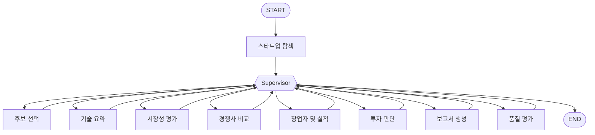

# AI Startup Investment Evaluation Agent (VentureSignal)

본 프로젝트는 반도체(저전력·고효율 AI 칩) 스타트업을 탐색하고, 기술·시장성·경쟁·창업자·실적 관점으로 분석한 뒤
반도체 특화 Scorecard로 투자 여부(INVEST/HOLD)를 판단해 투자 검토 보고서를 만드는 **Supervisor 패턴 기반 LangGraph 멀티 에이전트 시스템**을 설계/개발하는 프로젝트 임.

## Overview

- Objective : 반도체 AI 스타트업의 기술력, 경쟁 우위, 시장성, 창업자, 실적 등을 기준으로 점수화해서 투자 적합성 분석
- Method : LangGraph 멀티 에이전트(Supervisor 패턴), Agentic RAG(하이브리드 검색), 웹서치(Tavily)
- Pattern : Supervisor — 후보마다 분석 결과의 근거가 충분한지 확인해 다음 에이전트를 State로 정하고, 근거가 부족하면 해당 에이전트에 재작업을 요청해야 하는 구조라서 선정함. 후보를 하나씩 평가하다 INVEST가 나오면 멈추는 루프도 Supervisor 판단으로 흡수함.
- 동적 처리 : 기존에는 기술 → 시장성 → 경쟁사 → 창업자 순서와 투자 판단 후 분기가 그래프에 고정되어 있었음. 이제 모든 하위 노드가 Supervisor로만 돌아오고, Supervisor LLM이 State(각 에이전트의 상태·보고 요약·재작업 횟수)를 보고 `add_conditional_edges`로 다음 노드를 정함. 실행 순서는 코드가 아니라 프롬프트의 지침과 LLM 판단으로 정해지므로 실행마다 (1) 에이전트 실행 순서, (2) 근거 부족 시 재작업 횟수, (3) 후보 전환·종료 시점, (4) 에이전트 실패 시 재시도·제외, (5) 보고서 품질 미달 시 재작성 횟수가 달라짐.


## Features

- PDF 자료 기반 정보 추출: 「국내외 AI 반도체 기업 통합 RAG 조사자료」 150쪽(50개 기업, 기술·시장 공통 주제 각 15개, 출처 90개)을 페이지 단위(청크 140개)로 색인해 검색
- 질의 조건(예: "국내", "상장사 제외")을 반영해 Top-3 후보 기업 탐색
- RAG와 웹서치로 기술·시장·경쟁·창업자·실적을 분석하고, 결과마다 출처(출처 ID·URL)를 남기며 확인되지 않은 정보는 추정하지 않음
- 분석과 채점 분리: 분석 에이전트는 근거만 수집하고, 투자 판단 에이전트만 Scorecard로 채점해 INVEST/HOLD 판정
- 평가표 (Score Table 방식)
  - 창업자(10%) - 분야 전문성, 이력
  - 시장성(15%) - 시장 규모, 성장 가능성
  - 제품/기술력(35%) - 성능, 완성도
  - 경쟁 우위(25%) - 독점적 자산, 모방 난도
  - 실적(10%) - 고객 확보, 매출
  - 투자조건(5%) - 다음 라운드까지의 런웨이 확보 가능성
  - 투자 여부를 판단하는 기준점은 실제 IPO에 성공한 기업의 점수
- 반도체 특화 Scorecard: 기술 복잡도가 높고, 설계 IP·공정 노하우 등 진입장벽이 높아 확보한 우위가 오래 유지되는 특성을 반영해 기술력(15→35%)·경쟁 우위(10→25%) 비중 상향
- Supervisor 동적 라우팅: 하위 에이전트가 돌아올 때마다 LLM이 보고를 평가하고 다음 에이전트를 선택. 순서·의존 관계는 프롬프트에 두고, 코드는 종료·안전 불변 조건(분석 없이 채점하지 않기, 재작업 상한)만 검사하며 LLM 실패 시 규칙 기반으로 대체
- 근거 충분성 평가와 재작업: 근거가 부족하다고 평가한 에이전트를 에이전트별 상한 안에서 재작업. 이때 Supervisor가 "부족한 항목"과 웹 검색어를 State(`rework_notes`)에 남기면 재작업되는 에이전트(기술 요약, 시장성 평가, 경쟁사 비교, 창업자·실적)가 검색어와 프롬프트에 반영
- 실패 복구: 분석 에이전트가 예외로 실패해도 그래프가 멈추지 않고, 재시도 후에도 실패하면 해당 항목을 미확인으로 두고 진행
- 확증 편향 방지 전략 : 분석 에이전트는 회사 공개 주장과 독립 검증을 구분하고 확인되지 않은 정보는 미확인으로 남김. 보고서 품질 평가에서는 출처 하나에 인용이 몰리는지, 서로 다른 출처가 최소 몇 건인지, 분석 결과에 위험 근거 없이 강점만 있는지 확인해 미달이면 보고서를 다시 씀
- 보고서 품질 평가 : 보고서 생성 후 Groundedness / 중립성 / 편향 통제 3개 항목을 결정적 검사 + LLM Judge(Hybrid)로 판정. 미달이면 지적 사항을 반영해 보고서를 다시 쓰고, 재작성 상한에서 종료. Judge의 지적은 보고서 원문 인용과 분석 결과의 수치 대조로 검증해 근거 없는 지적을 버림
- 결과: HOLD면 다음 후보로 반복하고, 최종 결과를 SUMMARY~REFERENCE 양식(최대 10쪽 PDF)의 투자 보고서로 생성. 보고서에는 분석 과정(재작업·제외 이력)도 함께 기재

## Tech Stack

- Framework : LangGraph 1.2.12, LangChain 1.4.3 (Python 3.11)
- LLM/Generator : OpenAI gpt-6-luna (분석·요약·보고서 생성, Supervisor 라우팅)
- LLM/Judge : OpenAI gpt-6-luna (투자 판단 채점, 보고서 품질 평가)
- Retrieval : Qdrant 로컬 모드 (bge-m3 Dense + Sparse 하이브리드, RRF) - 탐색 평가 30건 중 평균 23.2건 통과 (Top-3가 모두 정답 후보 5곳 안, 5회 평균)
- Embedding : BAAI/bge-m3 (오픈소스, MIT) — 한·영 혼용 문서 대응, Dense + Sparse 하이브리드를 한 모델로 지원, 최대 8,192 토큰, Multi-vector 확장성. 비교 후보 gte-multilingual-base보다 검색 품질을 우선해 선정
- Web Search : Tavily
- Observability : 결정 로그(JSON Lines) + LangSmith 트레이싱(`trace_id` 태그)

## Agents

### 0. Supervisor (조정 계층, LLM)

후보 평가의 모든 분기를 State로 결정한다. 하위 에이전트(보고서 작성·품질 평가 포함)는 Supervisor와만 통신하고 서로 직접 연결되지 않는다.

- 분석 단계: 하위 에이전트가 돌아올 때마다 LLM이 (1) 방금 온 보고가 근거로 충분한지 평가하고 (2) 다음에 시킬 에이전트를 고른다(아직 실행하지 않은 에이전트 / 근거 부족한 에이전트 재작업 / 분석이 끝났으면 투자 판단). 재작업이면 부족한 항목과 웹 검색어도 함께 넘긴다. 실행 순서·의존 관계·재작업 기준은 코드가 아니라 프롬프트(`prompts/supervisor.py`)에 있다.
- 코드가 검사하는 불변 조건: 필요한 분석이 끝나기 전에 투자 판단으로 가지 않는다 / 재작업은 에이전트별 상한 안에서만, 이미 제외한 에이전트는 다시 시키지 않는다 / 다음 행동은 실제 노드 이름으로만 받는다(구조화 출력). 어기면 한 번 다시 묻고, 그래도 안 되거나 LLM 호출이 실패하면 규칙 기반 로직으로 대신한다.
- 규칙으로 처리하는 전이: 후보 선택, 판정 후의 다음 후보·보고서(INVEST면 종료, HOLD면 다음 후보, 소진이면 보고서), 에이전트 실행 실패의 재시도·제외, 보고서 단계(작성 → 품질 평가 → 통과면 종료, 미달이면 재작성), `max_steps` 강제 이동
- 입력/출력: 제어 메타와 `evaluations`의 보고 요약을 읽고 제어 필드(`next_agent`, `step_count`, `last_decision`, `node_status`, `rework_count`, `rework_notes`)만 쓴다. LLM이 쓴 평가와 사유는 `last_decision`과 결정 로그에 남는다.

### 1. 스타트업 탐색 에이전트 (RAG)

질의에서 조건을 추출하고, 사전 구축한 조사자료 인덱스를 하이브리드 검색·재정렬해 Top-3 후보 기업을 찾는다.

- 사전 1회: `python -m rag.ingest`가 PDF를 페이지별로 읽어 메타데이터(회사, 기술/시장성, 국내/해외, 분야, 출처 번호)를 붙이고, bge-m3 의미 벡터(Dense, 1024차원)와 단어 벡터(Sparse, 전문용어 정확 일치)로 Qdrant에 저장 (출처 목록 10쪽은 별도 저장)
- ① 조건 추출(`query_parser.py`): LLM이 질의에서 "국내", "상장사 제외" 같은 조건 추출 (LLM 실패 시 규칙 기반 폴백)
- ② 검색(`retrieval.py`): 질의도 같은 방식으로 벡터화해 의미·단어 검색을 각각 수행하고, 두 순위표를 RRF로 결합
- ③ 재정렬(`ranking.py`): 조건에 맞지 않는 회사를 제외하고, 분야·기술 용어가 일치하면 가점 → Top-3
- 어기면 오답인 조건(상장 제외, 후기 투자 등)만 필터로 제거하고, 분야·용어 일치는 가점으로 반영 → 평가 30건 중 통과 8건(벡터 검색만) → 23~24건
- 검색 대상은 회사당 기술 페이지 1장(총 50장)이라 결과가 곧 회사 목록이며, "국내" 요구 시 검색 전에 국내 회사 8곳만 남김
- 기업 상태·탐색 태그는 PDF 본문에서 따로 읽어(`catalog.py`) 필터·점수에 사용하고, 상장·인수 기업은 질의가 비상장·독립을 요구할 때 제외

### 2. 후보 선택 (함수)

후보 목록에서 아직 평가하지 않은 후보 1곳을 꺼내 `current_candidate`로 지정하고 `candidate_index`를 1 증가시킨다. Supervisor가 후보를 아직 꺼내지 않았거나 이전 후보가 HOLD로 끝났을 때 이 노드로 보낸다.

### 3. 기술 요약 에이전트 (RAG + 웹서치)

후보 기업의 기술을 조사자료(PDF) 검색 → 1차 요약 → 웹서치 보강 → 출처 검수 순서로 분석해, 근거가 확인된 내용만 `technology`로 정리한다.

- 후보 기업의 `company_id`로 조사자료(PDF)의 기업 기술 페이지를 조회하고, 기술 공통 주제를 하이브리드 검색(bge-m3 Dense + Sparse)으로 보강
- 조사자료 기반 1차 요약으로 핵심 기술, 제품, 개발 단계, 성능·전력, 강점과 한계 정리
- 조사자료만으로 파악하기 어려운 양산·고객, SDK, 벤치마크 정보는 웹서치로 찾아 2차 요약에서 보강
- 출처 검수를 통해 실제 조회한 자료의 출처(source_id·URL)만 남기고, 출처 없는 수치와 검색 결과 본문에 없는 웹 수치는 제외
- 공개 사실, 회사 주장, 분석을 구분하고 웹에서 가져온 내용은 `web`으로 남김
- 미확인 정보는 추정하지 않고 추가 확인 항목(unverified)으로 분류하며, 근거가 없으면 근거 부족으로 반환

### 4. 시장성 평가 에이전트 (RAG + 필요 시 웹서치)

기업별 시장성 자료와 시장 공통 자료로 먼저 분석하고, 정보가 부족할 때만 웹서치로 보완해 `market`으로 정리한다.

- RAG 검색 범위: 기업별 시장성 페이지(`company_market`)와 시장 공통 주제(`market_topic`)
- 웹서치 대상: 시장 규모·성장 또는 고객 수요·도입 (기업당 목적별 최대 1회, 전체 최대 2회, 검색당 결과 3개)
- 정리 항목: 목표 고객, 시장 규모(범위·연도·단위·출처), 성장 요인, 수익 구조, 도입 장벽
- 성장 요인은 기업 매출 성장과 구분하며, 시장 성장만으로 기업 매출을 예측하지 않음
- 시장 규모 등 확인하지 못한 정보는 미확인으로 별도 기록

### 5. 경쟁사 비교 에이전트 (웹서치)

평가 기업 확인 → 웹 검색(최대 3회) → 경쟁 제품 비교 → 결과 제출 → 출처 URL 검증 순서로 진행하고, 검증을 통과한 결과만 `competition`으로 저장한다.

- 현재 평가 기업과 같은 고객 문제를 해결하는 경쟁 제품을 찾아 비교 (입력: `current_candidate`, `candidates`의 이름·설명·사업 분야)
- Tavily 웹서치, 검색당 최대 5개 결과
- 비교 항목: 제품의 용도·고객, 성능·전력, 가격·도입 조건, 강점·약점, 출처
- 근거 URL과 경쟁 제품 출처 URL이 실제 검색 결과에 있는지 검증. 실패 시 수정 또는 재검색(`recursion_limit=24`)하고, 끝까지 통과하지 못하면 저장하지 않고 오류 발생
- 비교 조건이 다르거나 확인되지 않은 정보는 우열로 단정하지 않고 별도 기록
- 출력 `details`: 경쟁사별 제품 정보(`peer_products`), 비교 조건, 미확인 정보, 핵심 위험 (`evidence`는 검색 결과 URL)

### 6. 창업자 및 실적 에이전트 (웹서치)

창업자·실적·투자조건을 웹에서 조사해 `team`·`traction`·`deal_terms`로 정리한다.

- 기업명과 CEO 이름을 기반으로 창업자 및 공동창업자 정보 탐색
- LinkedIn과 공식 웹 자료에서 학력, 경력, 전문성, 논문 및 제품 실행 경험 수집
- 고객, PoC, 계약, 매출 및 상용화 실적 분석
- 투자 유치 이력, 기업가치, 투자조건 및 런웨이 확인
- 원문 인용 검증을 통해 근거가 확인된 사실만 분석 결과에 반영
- 미확인 정보는 추정하지 않고 추가 확인 항목으로 분류

### 7. 투자 판단 에이전트 (LLM)

6개 분석 결과를 받아 LLM이 항목별 점수(0~5)와 근거만 산출하고, 가중합·판정은 코드(`scoring.build_scorecard` / `scoring.decide`)로 계산한다.

- 입력: 현재 후보의 분석 결과 6개 (`technology`, `market`, `competition`, `team`, `traction`, `deal_terms`)
- Scorecard 비중: 제품/기술력 35% · 경쟁 우위 25% · 시장성 15% · 창업자 10% · 실적 10% · 투자조건 5%
- 판정 점수(핵심 점수): 필수 5항목(기술력·경쟁 우위·시장성·창업자·실적)의 가중합을 비중 합 95%로 나눠 100점으로 환산. 투자조건은 웹 조사로 확인이 어려워 참고용으로만 표시하고 총점에서 제외
- 하한값 59.3점: 상장에 성공한 기준 기업 3곳(싸이닉솔루션 57.9 · 그린리소스 60.0 · Ambiq 60.0)을 같은 방식으로 채점한 점수의 평균. 총점이 이 값을 넘으면 INVEST, 아니면 HOLD
- 필수 항목이 하나라도 미산정이면 총점 없이 근거 부족 HOLD (0점·기본점수로 채우지 않음). 총점이 하한값 ±5점 이내면 채점을 2회 더 해 항목별 중앙값 사용
- INVEST면 `selected_candidate`에 기업 ID를 기록한다. 이 판정을 보고 Supervisor가 보고서 단계로 보내거나(INVEST·후보 소진), 다음 후보로 보낸다(HOLD이고 후보가 남음)

### 8. 보고서 생성 에이전트 (LLM)

State 전체를 입력으로 설계 문서 E절 양식에 맞춘 마크다운 투자 보고서를 작성하고 PDF로 만든다. 표는 State 값을 옮겨 채우고(LLM 없이), LLM은 요약·항목별 근거·판단 이유·재검토 조건만 쓴다.

- 목차: SUMMARY → 사업 아이디어와 팀 → 실적·투자조건 → 시장·경쟁 → 기술력 → 리스크 → 종합 평가 → REFERENCE (양식: `agents/report_writer/template.md`)
- `evidence`의 출처 ID·URL로 출처 번호를 만들고 REFERENCE에 서지정보 기재
- 전 후보가 HOLD이면 보류 사유와 재검토 조건을 후보별 전 항목의 점수·사유와 함께 기재
- 분석의 한계에 분석 과정(Supervisor 판단 횟수, 재작업·제외 이력)을 기재
- PDF는 최대 10쪽(넘으면 글자 크기는 유지하고 내용을 요약), 파일명은 실행 시작 시각을 포함(`{YYYYMMDD_HHMMSS}_{company_id}_투자검토보고서.pdf`, 보류는 `{YYYYMMDD_HHMMSS}_보류_투자검토보고서.pdf`)
- 품질 평가에서 미달 지적이 오면 그 사유를 반영해 다시 작성

### 9. 보고서 품질 평가 (결정적 검사 + LLM Judge)

보고서 작성이 끝나면 Supervisor가 이 노드로 보내고, 결과를 다시 Supervisor가 받아 통과면 종료, 미달이면 보고서를 다시 쓰게 한다.

- Groundedness: 본문 `[번호]` 인용이 REFERENCE에 있는지 확인하고, LLM Judge가 분석 결과에 없는 사실·수치를 단정한 문장을 인용과 함께 지적(인용문이 보고서에 없거나 수치가 분석 결과에 있으면 지적을 버림)
- 중립성: 근거 없는 단정·추천 표현, 후보 간 우열을 직접 서술한 문장을 검사(INVEST/보류 판정과 그 이유는 허용)
- 편향 통제: 출처 하나에 인용이 몰리는 비율, 서로 다른 출처 수, 분석 결과에 강점만 있고 위험 근거가 없는 경우를 검사
- 결과는 `quality_verdict`(항목별 통과 여부와 지적 사항)로 State에 남고, 재작성 횟수에는 상한이 있다

## State Schema

- 제어 vs 페이로드 분리 : `GraphState`를 작업 결과(query, candidates, evaluations, sources, report, quality_verdict)와 제어 메타(trace_id, started_at, step_count, next_agent, node_status, rework_count, rework_notes, last_error 등)로 나눔. Supervisor는 제어 필드만 쓰고 하위 에이전트는 자기 분석 필드만 씀.
- 관측성 위치 : 결정 로그(node, decision, reason)는 logger/파일(`outputs/logs/{trace_id}.jsonl`)과 LangSmith로 외부 적재. State에는 마지막 결정 1건(`last_decision`)만 보관.
- 지속성 비용 : 재작업 이력은 카운터(`rework_count`)와 최신 지시 1건(`rework_notes`)으로만 보관하고, `evidence`는 본문이 아니라 출처 ID·URL만 저장해 체크포인트가 커지지 않음.
- 상관 : 실행 시작 시 `trace_id`(uuid)를 생성해 State, 결정 로그, LangSmith run metadata·tags에 동일하게 기록.
- 재개/복구 : `node_status`, `rework_count`, `last_error`, `step_count`로 진행 상태와 실패를 파악하고, 실패 시 재시도(상한)/제외(미확인)를 Supervisor가 결정.
- 동시 처리 : 부분 갱신되는 dict 필드(`evaluations`, `sources`, `node_status`, `rework_count`, `rework_notes`)는 reducer(`merge_evaluations`, `merge_sources`, `merge_dict`)로 키 단위 병합해 서로의 결과가 유지됨.
- 종료 보장 : `max_steps`(Supervisor 진입 상한), 에이전트별 재작업 상한(`MAX_REWORK`), 보고서 재작성 상한(`MAX_REVISIONS`), LangGraph `recursion_limit`(`max_steps`에서 계산)을 함께 적용하고 초과 시 보고서 단계로 강제 이동.

## Architecture



모든 하위 노드는 Supervisor로만 오가고 노드끼리 직접 연결되지 않는다(Supervisor → 노드: 일을 시킴, 노드 → Supervisor: 보고). 다음에 어느 노드로 갈지는 Supervisor가 State를 보고 `add_conditional_edges`로 정한다.

| 구분 | 노드 | Supervisor의 판단 |
|---|---|---|
| 후보 흐름 | 후보 선택, 투자 판단 | 후보를 아직 꺼내지 않았으면 후보 선택. 투자 판단 후 INVEST면 보고서 단계로, HOLD이고 후보가 남으면 다음 후보, 소진이면 보고서 단계로 |
| 분석 | 기술 요약, 시장성 평가, 경쟁사 비교, 창업자 및 실적 | 돌아온 보고가 충분한지 LLM이 평가하고, 아직 실행하지 않은 에이전트 / 근거가 부족한 에이전트의 재작업 / 분석이 끝났으면 투자 판단 중에서 선택 (실행 순서는 고정되어 있지 않음) |
| 보고서 단계 | 보고서 생성, 품질 평가 | 보고서 작성 → 품질 평가 → 통과하면 종료(END), 미달이면 재작성(상한 있음) |
| 공통 | 모든 노드 | 에이전트 실행 실패는 재시도·제외, `max_steps`를 넘으면 보고서 단계로 강제 이동 |

State 흐름: `query` → `candidates`(Top-3) → `current_candidate` → `evaluations`(기업별 분석·점수 누적, 덮어쓰지 않고 병합) → `report` → `quality_verdict` (INVEST 기업은 `selected_candidate`에 기록)

## Directory Structure

```
VentureSignal/
├── agents/                   # 에이전트별 폴더 (진입점: node.py 의 run(state))
│   ├── supervisor/           # 조정 계층: LLM 라우팅(llm_policy.py), 규칙 대체(node.py, policy.py), 실패 보호(guard.py), 결정 로그(audit.py)
│   ├── startup_search/       # 스타트업 탐색 (RAG)
│   ├── candidate_select/     # 후보 선택 (함수)
│   ├── tech_summary/         # 기술 요약 (RAG + 웹)
│   ├── market_eval/          # 시장성 평가 (RAG + 웹)
│   ├── competitor_compare/   # 경쟁사 비교 (웹)
│   ├── founder_traction/     # 창업자 및 실적 (웹)
│   ├── investment_decision/  # 투자 판단 (LLM, scoring.py)
│   ├── report_writer/        # 보고서 생성 (LLM, template.md)
│   └── quality_check/        # 보고서 품질 평가 (결정적 검사 + LLM Judge)
├── prompts/                  # 에이전트별 LLM 프롬프트 (<에이전트>.py, supervisor.py 포함)
├── core/                     # 공용 State·LLM·설정, 재작업 피드백(rework.py)
├── graph/                    # LangGraph 조립 (builder.py)
├── rag/                      # PDF 파싱·임베딩·Qdrant·검색
├── tools/                    # Tavily 웹검색
├── data/                     # 조사자료 PDF (index/ 는 로컬 생성)
├── docs/                     # 설계 문서
├── tests/                    # pytest
├── outputs/                  # 실행 결과 저장 (보고서 md·PDF, logs/ 결정 로그)
├── main.py                   # 실행 스크립트
└── requirements.txt
```

## Usage

```bash
# 환경 설정 (최초 1회)
uv venv -p 3.11 .venv && uv pip install -p .venv -r requirements.txt   # 또는 python -m venv + pip
cp .env.example .env                   # LLM_PROVIDER/LLM_MODEL, API 키(Tavily 등) 설정
python -m rag.ingest                   # PDF → data/index/ (Qdrant + sources.json), bge-m3 다운로드 약 2.3GB

# 실행
python main.py "국내 저전력 엣지 AI 칩"   # 보고서(md·PDF)는 outputs/, 결정 로그는 outputs/logs/ 에 저장

# 테스트
pytest
```

- LangSmith 트레이싱을 켜려면 `.env`에 LangSmith 설정을 추가한다. 실행 끝에 출력되는 `trace_id`(태그 `trace:<trace_id>`)로 해당 실행의 트레이스를 찾을 수 있다.
- `SUPERVISOR_LLM=off`로 실행하면 Supervisor가 LLM 없이 규칙 기반으로만 동작한다.

## Contributors

- 임예리 : 스타트업 탐색 에이전트, 보고서 생성 에이전트, LangGraph 통합, Supervisor 허브 구조 (에이전트 노드 연결·분기 통합 / 질의 조건 추출, 하이브리드 검색·RRF 결합, 조건 필터·재정렬 / 투자 검토·보류 보고서 작성, PDF 변환 / Supervisor 허브 구조 전환(모든 하위 노드가 Supervisor로만 복귀하도록 그래프 재구성, `add_conditional_edges` 분기) / Supervisor LLM 라우팅 설계(보고 평가·다음 에이전트 선택 프롬프트, 구조화 출력) / 보고서 PDF 개선)
- 김상현 : 기술 요약 에이전트, Supervisor 안전 장치 (RAG 기술 분석, 웹 보강, 출처 검수 / 종료·안전 불변 조건 검사(분석 전 투자 판단 방지, 재작업 상한) / LLM 실패 시 규칙 기반 대체와 에이전트 실행 실패 보호(재시도·제외) / 기술 요약 재작업 피드백(부족 항목·검색어 반영) / Supervisor 시나리오 테스트)
- 김영준 : 시장성 평가 에이전트, 투자 판단 에이전트, State Schema·보고서 품질 평가 (RAG 시장 분석, 필요 시 웹 보완, 시장 규모·성장 요인 정리 / 여섯 항목 0~5점 LLM 채점, 출처·형식 검증, 100점 기준 가중합 산출 / State Schema 설계(제어/페이로드 분리, reducer, 종료 보장 등 7항목과 설계 근거·주석) / 보고서 품질 평가 노드(Groundedness·중립성·편향 통제, 결정적 검사 + LLM Judge, Judge 지적의 수치 대조 검증) / 시장성 평가 재작업 피드백)
- 김재욱 : 경쟁사 비교 에이전트, 관측성·실행 검증 (웹서치 경쟁 제품 비교, 출처 URL 검증 / 관측성·상관(결정 로그 JSON Lines, `trace_id`, LangSmith 트레이싱 연동) / `max_steps`·`recursion_limit` 산정(진입 횟수 측정) / 경쟁사 비교 재작업 피드백 / 전체 실행 검증(라우팅·재작업 로그 분석, 트레이스 호출량 분석))
- 황민진 : 창업자 및 실적 에이전트 (창업자 이력·실적·투자조건 조사, 원문 인용 검증 / 초안 검증 오류 수정(스키마에 맞지 않는 항목만 제외) / 재작업 시 부족 항목 검색 배치 추가와 재작업 피드백 State(`rework_notes`) 연동 / 재작업 피드백·에이전트 테스트)
- 전체 : 시스템 구조 설계 (공통 설계 문서 작성, 에이전트 역할 분담과 State·Scorecard 구조 설계)
